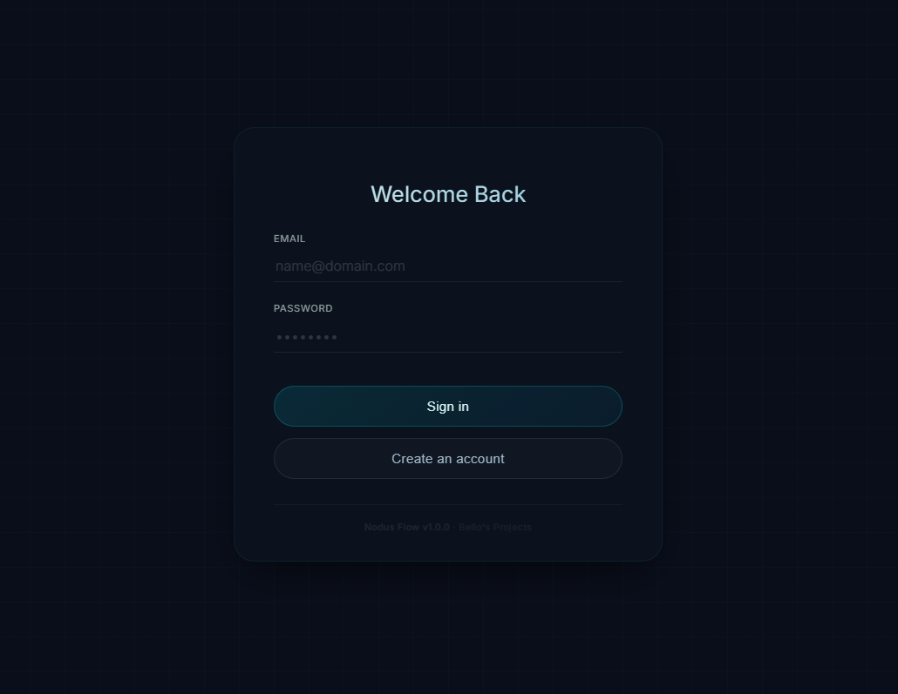
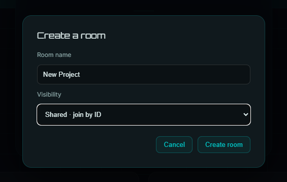
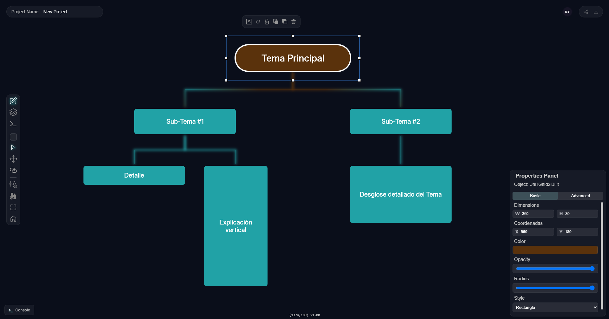
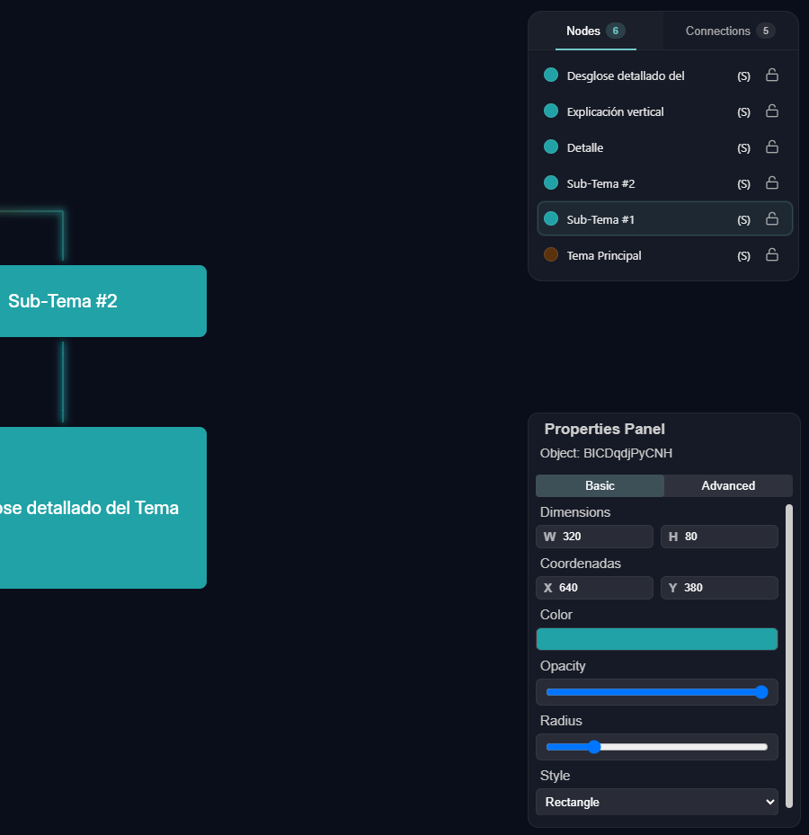
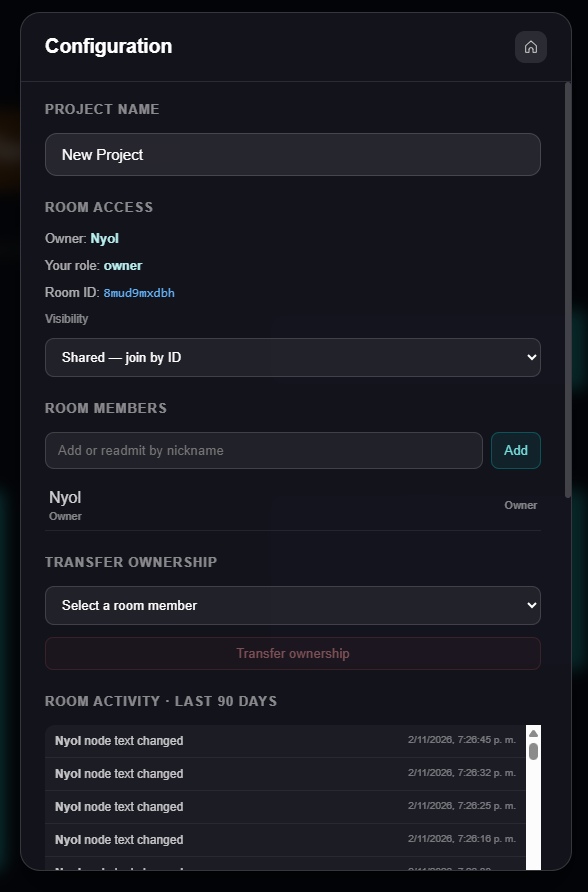
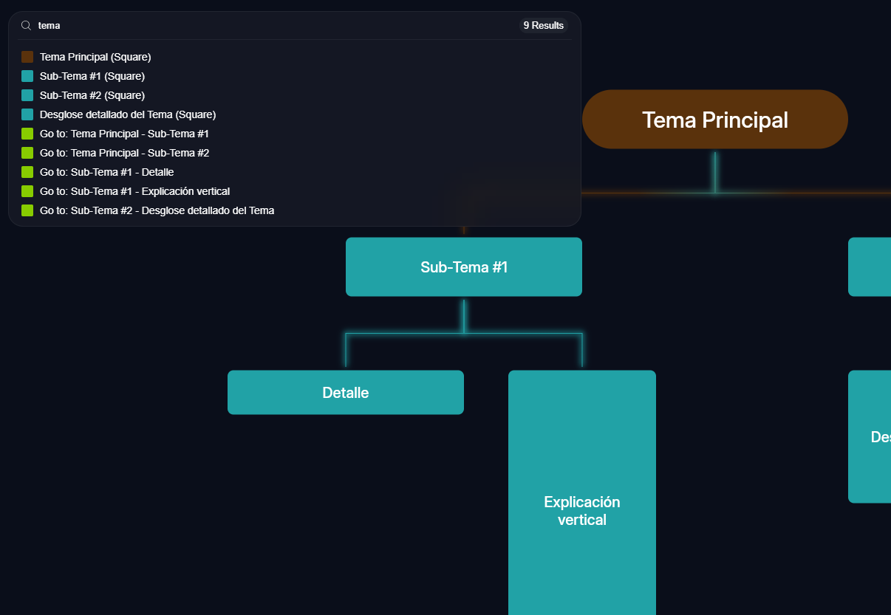
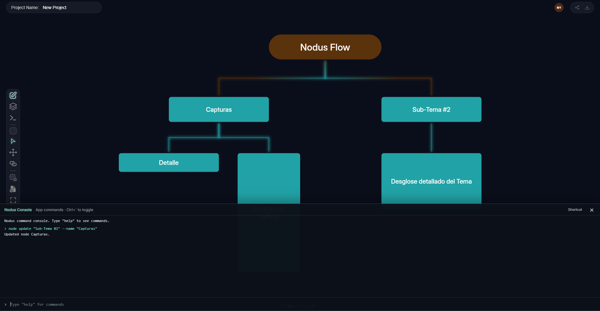
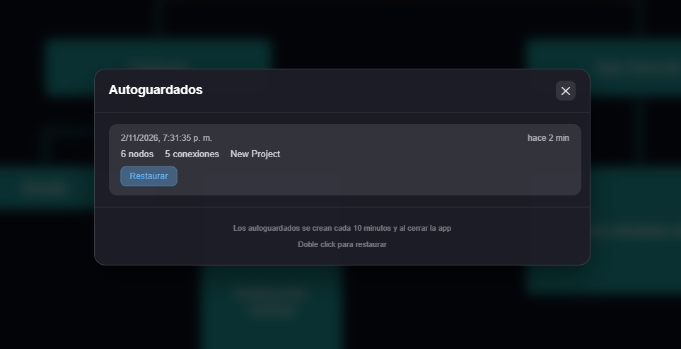
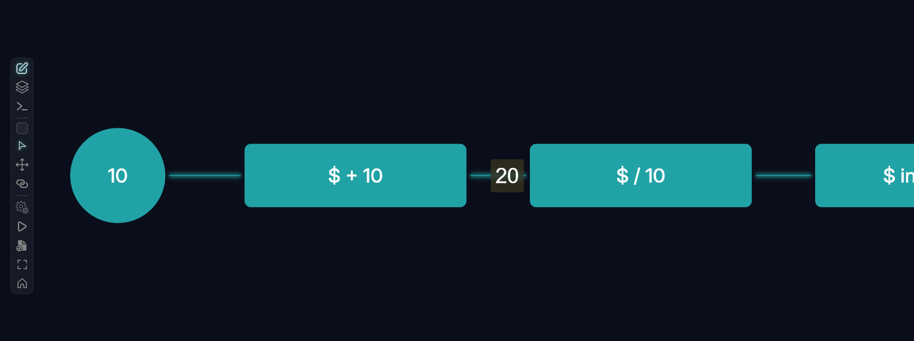

# Nodus Flow

Nodus Flow es una aplicación de escritorio para crear y compartir diagramas interactivos. Permite editar nodos y conexiones sobre un canvas, colaborar en salas con distintos permisos y guardar o recuperar proyectos.

## Funcionalidades

### Cuentas y salas

- Registro e inicio de sesión con correo, contraseña y apodo.
- Crear salas privadas, compartidas (acceso por ID) o públicas (visibles en el lobby).
- Ver, abrir y administrar las salas propias o a las que se pertenece; los propietarios pueden archivarlas, restaurarlas o eliminarlas.
- Solicitar acceso a una sala privada.
- Abrir una sala desde el lobby o mediante un enlace `nodus:` compatible.

### Editor de diagramas

- Canvas desplazable y ampliable, con cuadrícula y ajuste de nodos a la cuadrícula.
- Crear, seleccionar, mover, duplicar, copiar, pegar, bloquear y eliminar nodos.
- Conectar nodos y administrar las conexiones desde el canvas o el panel de capas.
- Usar nodos rectangulares, elípticos y en forma de diamante.
- Cambiar el tamaño, posición, color, opacidad, radio y estilo de los nodos; añadir propiedades personalizadas.
- Ajustar el estilo de las conexiones y agregarles propiedades.
- Seleccionar varios nodos para aplicar acciones en lote, cambiar su orden visual o ajustar su altura.
- Usar deshacer y rehacer para revisar cambios.
- Consultar las capas de nodos y conexiones, saltar a un nodo y bloquearlo o desbloquearlo.
- Ver información de cámara e historial de acciones cuando esas opciones están habilitadas en la configuración.

### Colaboración y permisos

- Sincronizar cambios del diagrama en tiempo real y ver quién está conectado.
- Compartir una sala mediante su ID y consultar la actividad reciente.
- Roles de propietario, editor y lector. Los lectores pueden inspeccionar y desplazarse por el diagrama, pero no editarlo.
- El propietario puede cambiar la visibilidad, agregar miembros por apodo, asignar roles, bloquear o readmitir miembros, resolver solicitudes de acceso y transferir la propiedad.
- Enviar pings para llamar la atención de otros participantes.

### Herramientas y automatización

- **Paleta de comandos** (`Ctrl+K`): buscar nodos, saltar a ellos y ejecutar acciones de edición, selección, conexiones, zoom, importación y exportación.
- **Consola Nodus** (`Ctrl + Backquote` por defecto): disponible también en inicio de sesión, registro y licencia. Permite consultar el estado visible y operar el lobby, el editor y la ventana con comandos semánticos; el atajo se puede cambiar desde la consola.
- **Integración local con IA y herramientas externas**: MCP por HTTP y un adaptador `stdio` incluido en la aplicación. AI Access puede configurar VS Code/Copilot, Claude Desktop y Cursor con confirmación y copias de respaldo; las credenciales se guardan en el almacén seguro del sistema.
- **Simulación de flujo de datos**: al habilitar el modo en la configuración, ejecutar el flujo desde un nodo elíptico seleccionado y visualizar su recorrido por las conexiones.
- **Evaluación Heza** desde la paleta de comandos.

El inicio de sesión y el registro desde la consola solicitan la contraseña en un campo enmascarado; las contraseñas no aparecen en el historial. Las acciones destructivas y el cierre de sesión solicitan confirmación, que se puede omitir explícitamente con `--yes` cuando el comando lo admite.

La consola acepta comandos de Nodus; no es una terminal y no ejecuta Bash, PowerShell, JavaScript ni comandos del sistema.

### Importación, exportación y recuperación

- Exportar diagramas como PNG, SVG o JSON e importar diagramas JSON.
- Crear autoguardados cada 10 minutos y al cerrar el editor. Se conservan hasta cinco versiones por sala en el almacenamiento local de la aplicación.
- Consultar y restaurar una versión desde el panel de autoguardados. Las versiones con más de siete días se limpian al abrir el editor.

### Aplicación de escritorio

- Interfaz ejecutada en una ventana nativa mediante Tauri.
- Atajos y controles de ventana para pantalla completa; no se usan las acciones web de menú contextual ni de recarga del navegador.

## Atajos de teclado

Los atajos de edición requieren permisos de propietario o editor. En macOS, usa `⌘` donde se indica `Ctrl/Cmd`.

| Atajo | Acción |
|---|---|
| `Ctrl/Cmd + K` | Abrir o cerrar la paleta de comandos |
| `Ctrl + Backquote` | Abrir o cerrar la consola Nodus (configurable) |
| `N` | Herramienta de creación de nodos |
| `V` | Herramienta de selección |
| `H` | Herramienta de movimiento |
| `C` | Herramienta de conexión |
| `Espacio` | Mantener temporalmente el modo de movimiento |
| `P` | Enviar un ping |
| `Ctrl/Cmd + C`, `X`, `V`, `D` | Copiar, cortar, pegar o duplicar la selección |
| `Ctrl/Cmd + Z`, `Y` o `Shift + Z` | Deshacer o rehacer |
| `Ctrl/Cmd + A` | Seleccionar todos los nodos |
| `Ctrl/Cmd + Shift + A` | Quitar la selección |
| `Ctrl/Cmd + I` | Invertir la selección |
| `Ctrl/Cmd + Shift + U` | Seleccionar nodos sin conexiones |
| `Ctrl/Cmd + L` | Mostrar u ocultar el panel de capas |
| `Ctrl/Cmd + Shift + P` | Mostrar u ocultar el panel de propiedades |
| `F11` o `Ctrl + F` | Alternar pantalla completa |

`F5` y `Ctrl/Cmd + R` no recargan la aplicación.

## Consola Nodus

Escribe `help` dentro de la consola para consultar la sintaxis. Los grupos de comandos disponibles son:

Consulta la [guía completa de la consola](docs/consola.md) para ver cada variación, parámetro, permiso, confirmación y ejemplo de uso.

Para conectar Copilot u otro cliente compatible, consulta la [guía de integración con IA](docs/integracion-ia.md) y la [referencia de capacidades para agentes](docs/agentes-nodus.md). La integración funciona en la aplicación Tauri, no en modo Vite; no expone credenciales de cuenta ni el intérprete Heza.

```text
app inspect [--json]
app home
app fullscreen [status|on|off|toggle]
auth status|view login|view signup|login <email>|signup <email> <nickname>|logout [--yes]
license status|retry|contact
console status|open|close|toggle|resize <height>|shortcut|history
toast list|click|dismiss <id>

project list|public|resume|info
project create "Nombre" [--visibility private|shared|public]
project open <id>
project rename "Nuevo nombre" [--project <id>]
project visibility set private|shared|public [--project <id>]
project lock|unlock|delete <id> [--yes]
project member list|add|ban|unban|role|owner ...
project request list|approve|reject|access ...
project activity list
project prop list|set|del ...

editor status|home|fullscreen|undo|redo|run|ping
editor panel list|open|close|toggle <panel>
editor tool list|set <tool>
editor layer-view nodes|connections
editor selection list|clear|all|invert|unconnected|select <node>...
editor clipboard copy|cut|paste|duplicate
editor camera center|zoom <0.1..5>|pan <x> <y>
editor share
editor autosaves list|restore <timestamp> [--yes]
editor export png [scale]|svg|json
editor import json
diagram export png [scale]|svg|json
diagram import json

node list|get|create|update|select|deselect|lock|unlock|delete ...
node prop list|set|del ...

connection list|get|select|create|complete|style|delete ...
connection prop list|set|del ...
canvas clear|reset|zoom <0.1..5>
generate MR2ER
eval <Heza expression>

help
clear
```

Los comandos de edición respetan el rol de la sala; los lectores conservan las acciones de consulta, navegación, compartir y exportación. Usa comillas para valores que contengan espacios. `--json` solicita una salida JSON cuando está disponible.

## Capturas de pantalla

### Acceso


### Creacion de salas y selector de visibilidad


### Vista del Editor


### Panel de capas y de Propiedades


### Configuracion de visibilidad, roles y registro de auditoria


### Paleta de Comandos


### Consola Nodus (No es una terminal de Windows)


### Autoguardados


### Flujo de Datos


## Desarrollo

### Requisitos

- Node.js y npm.
- Rust y los requisitos de compilación de Tauri 2 para tu sistema operativo.
- El sidecar nativo Heza correspondiente al target, que no se distribuye en este repositorio.

La autenticación, las salas, las licencias y la colaboración necesitan conexión con los servicios de Nodus Flow.

### Ejecutar en desarrollo

```bash
npm install
npm run tauri -- dev
```

Para ejecutar solo el servidor frontend de Vite:

```bash
npm run dev
```

### Compilar

```bash
npm run build
npm run tauri -- build
```

## Tecnologías

- Tauri 2 y Rust para la aplicación de escritorio.
- SolidJS y TypeScript para la interfaz.
- CanvasKit/Skia para renderizar el canvas.
- WebSockets para la colaboración en tiempo real.

## Licencia

Este proyecto se distribuye bajo la licencia MIT. Consulta [LICENSE](LICENSE).
